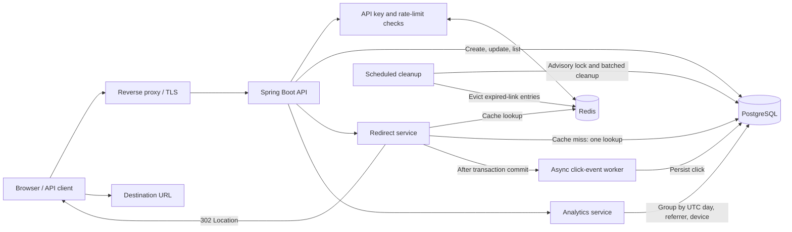

# URL Shortener & Click Analytics

A production-oriented Java 17 / Spring Boot REST API for creating short links, redirecting with HTTP 302, and reporting click analytics. PostgreSQL is the source of truth; Redis provides caching and distributed rate limiting when available.

## Features

- Create short links with generated or custom codes (`4`–`16` letters, digits, `_` or `-`).
- Update, patch, list, fetch and soft-delete links owned by an API key.
- Public `302 Found` redirects with `Cache-Control: no-store`.
- Click analytics grouped by UTC day, referrer host and device category.
- API keys hashed with HMAC-SHA-256 and a configurable pepper.
- Admin-only API key creation, listing and revocation.
- Redis cache-aside reads and atomic Lua rate limiting, with automatic database and in-memory fallbacks.
- Flyway migrations, schema validation and scheduled retention cleanup.
- Multi-instance-safe cleanup using a PostgreSQL advisory lock.
- Liveness/readiness probes, Prometheus metrics and graceful shutdown.
- Request correlation IDs, structured JSON errors and security headers.
- Docker Compose stack, multi-stage Dockerfile and GitHub Actions CI.

## Architecture



PostgreSQL is the source of truth. Redis is used for short-link caching and
distributed rate limits; redirects fall back to PostgreSQL on a cache miss.
Click events are persisted asynchronously after the redirect transaction
commits.

## Requirements

- Java 17+
- Maven 3.9+
- Docker Desktop with Docker Compose (for PostgreSQL, Redis and container builds)

## Quick start with Docker

```bash
cp .env.example .env
# Edit .env and fill in all secret values with strong, distinct secrets.
docker compose up --build -d
```

The API listens on `http://localhost:8080` and PostgreSQL/Redis are bound to `127.0.0.1` only. Use the `API_KEY` value from `.env` as the `X-API-Key` header. The configured bootstrap key is created as an admin at startup. Override `APP_HOST_PORT`, `POSTGRES_HOST_PORT` or `REDIS_HOST_PORT` if a host port is already in use.

The Docker image starts with the `prod` profile. Use `SPRING_PROFILES_ACTIVE=dev` only for local experiments; production runs fail fast when `APP_BASE_URL`, `API_KEY` or `API_KEY_PEPPER` are missing or too weak.

Compose requires non-empty secrets from `.env`; there are no working default credentials. The example file deliberately leaves secret values blank, so Compose refuses to start until they are provided.

```bash
curl http://localhost:8080/actuator/health/liveness
```

## Local development without the app container

```bash
cp .env.example .env
# Fill in all secret values, then keep REDIS_PASSWORD available
# to the local application process as an environment variable.
docker compose up -d postgres redis
SPRING_PROFILES_ACTIVE=dev REDIS_PASSWORD=your-redis-password mvn spring-boot:run
```

The local development key is `local-development-key`. The application defaults to the `prod` profile when no profile is selected, so explicitly activate `dev` for local development. Set `API_KEY` and `API_KEY_PEPPER` to strong random values everywhere else.

## Deployment

The full deployment guide lives in [DEPLOYMENT.md](./DEPLOYMENT.md) and covers:

- Configuration reference for all environment variables
- Production secrets and the fail-fast rules of the `prod` profile
- Local deployment with Docker Compose
- Production deployment with Docker Compose or a standalone JAR
- TLS termination and reverse proxy setup
- Health checks, smoke tests, backup and recovery
- Scaling and troubleshooting

Quick production checklist:

```bash
cp .env.example .env
# Fill in strong values: API_KEY, API_KEY_PEPPER, POSTGRES_PASSWORD,
# and set APP_BASE_URL to the public origin.
docker compose up --build -d
```

## API

All `/api/**` endpoints require the `X-API-Key` header. Redirects and actuator endpoints are public.

| Method | Path | Description |
|---|---|---|
| `POST` | `/api/urls` | Create a short URL (`201 Created`, `Location` header) |
| `GET` | `/api/urls?page=0&size=20` | List the current key's URLs (`size` 1–100) |
| `GET` | `/api/urls/{code}` | Fetch one URL owned by the current key |
| `PUT` | `/api/urls/{code}` | Replace the destination and optionally the expiry |
| `PATCH` | `/api/urls/{code}` | Partially update URL, expiry or active state |
| `DELETE` | `/api/urls/{code}` | Soft-delete a URL (`204 No Content`) |
| `GET` | `/api/urls/{code}/analytics?days=30` | Analytics for the last 1–365 UTC days |
| `GET` | `/{code}` | Public redirect (`302 Found`) |
| `GET` | `/api/keys` | List API keys (admin only, hashes never exposed) |
| `POST` | `/api/keys` | Create an API key (admin only; secret returned once) |
| `DELETE` | `/api/keys/{id}` | Revoke an API key (admin only) |

### Create a short URL

```bash
KEY=local-development-key
BASE=http://localhost:8080

curl -X POST "$BASE/api/urls" \
  -H 'Content-Type: application/json' \
  -H "X-API-Key: $KEY" \
  -d '{"url":"https://spring.io","customCode":"spring1","expiresAt":"2027-01-01T00:00:00Z"}'
```

`customCode` and `expiresAt` are optional. Expiry timestamps are ISO-8601 UTC instants and must be in the future.

```json
{
  "shortCode": "spring1",
  "shortUrl": "http://localhost:8080/spring1",
  "originalUrl": "https://spring.io",
  "active": true,
  "createdAt": "2026-11-06T12:00:00Z",
  "expiresAt": "2027-01-01T00:00:00Z"
}
```

### Update and manage links

```bash
# Full update; clearExpiry is optional
curl -X PUT "$BASE/api/urls/spring1" \
  -H 'Content-Type: application/json' -H "X-API-Key: $KEY" \
  -d '{"url":"https://spring.io/projects/spring-boot","clearExpiry":true}'

# Partial update: change expiry, or deactivate/reactivate the link
curl -X PATCH "$BASE/api/urls/spring1" \
  -H 'Content-Type: application/json' -H "X-API-Key: $KEY" \
  -d '{"expiresAt":"2027-06-01T00:00:00Z","active":false}'

# Paginated list
curl "$BASE/api/urls?page=0&size=20" -H "X-API-Key: $KEY"

# Soft delete
curl -X DELETE "$BASE/api/urls/spring1" -H "X-API-Key: $KEY"
```

`PATCH` accepts any combination of `url`, `expiresAt`, `clearExpiry` and `active`. `expiresAt` and `clearExpiry=true` are mutually exclusive. Reactivating a link whose expiry is in the past is rejected.

### Redirect

```bash
curl -i "$BASE/spring1"
```

Unknown, expired, deactivated or deleted codes return `404`. Redirect responses are marked `no-store` and include `Referrer-Policy: no-referrer`.

### Analytics

```bash
curl "$BASE/api/urls/spring1/analytics?days=30" -H "X-API-Key: $KEY"
```

```json
{
  "totalClicks": 3,
  "byDay": {"2026-11-05": 1, "2026-11-06": 2},
  "byReferrer": {"news.example.org": 2, "direct": 1},
  "byDevice": {"MOBILE": 2, "DESKTOP": 1}
}
```

The series is gap-filled for every UTC day in the requested range. `totalClicks` is the sum for that range. Referrers are normalized to their host and the response is limited to the top 50 sources; clicks without a referrer are reported as `direct`. Device categories are `MOBILE`, `TABLET`, `DESKTOP`, `BOT` and `UNKNOWN`.

Only the normalized referrer host is stored; raw referrer paths and query strings are discarded. For deployments that should only redirect to an organization's domains, configure `ALLOWED_DESTINATION_HOSTS` with comma-separated exact hostnames. When unset, any valid HTTP(S) host is accepted, as expected for a general-purpose shortener.

### API key management

The key configured through `API_KEY` is created as an admin key at startup and promoted if it already exists. Admin keys can manage other keys:

```bash
# Create a non-admin key; copy the secret now, it is never shown again
curl -X POST "$BASE/api/keys" \
  -H 'Content-Type: application/json' -H "X-API-Key: $KEY" \
  -d '{"name":"reporting"}'

# List keys
curl "$BASE/api/keys" -H "X-API-Key: $KEY"

# Revoke by id
curl -X DELETE "$BASE/api/keys/2" -H "X-API-Key: $KEY"
```

Keys are stored only as HMAC-SHA-256 hashes. The last active admin key cannot be revoked. A revoked bootstrap key is not recreated automatically; change `API_KEY` or restore the key directly in the database.

### Errors

Errors use a consistent JSON payload and include the `X-Request-Id` correlation ID:

```json
{
  "timestamp": "2026-11-06T12:00:00Z",
  "status": 400,
  "error": "Bad Request",
  "message": "Validation failed",
  "path": "/api/urls",
  "requestId": "6f1c2c1e-6a0f-4f5e-9d67-2f3f7e4a1b2c",
  "fieldErrors": {"url": "URL must use http or https"}
}
```

Rate-limited responses return `429 Too Many Requests` with a `Retry-After` header.

## Configuration

All settings can be supplied as environment variables. Durations use ISO-8601 (`PT1M`, `P30D`).

| Variable | Default | Purpose |
|---|---|---|
| `SPRING_PROFILES_ACTIVE` | `prod` | `prod` enables fail-fast secret validation; use `dev` for local development |
| `SERVER_PORT` | `8080` | HTTP port |
| `APP_BASE_URL` | `http://localhost:8080` | Base URL used in create responses |
| `DATABASE_URL` | `jdbc:postgresql://localhost:5432/shortener` | JDBC URL |
| `DATABASE_USERNAME` / `DATABASE_PASSWORD` | `shortener` | PostgreSQL credentials |
| `DB_POOL_SIZE` / `DB_MIN_IDLE` | `10` / `2` | Hikari pool bounds |
| `REDIS_HOST` / `REDIS_PORT` / `REDIS_PASSWORD` | `localhost` / `6379` / empty | Redis connection |
| `CACHE_TTL` | `PT1H` | Short-link cache lifetime |
| `API_KEY` | `local-development-key` | Bootstrap admin API key |
| `API_KEY_PEPPER` | `local-development-pepper` | HMAC pepper for stored key hashes |
| `RATE_LIMIT_REQUESTS` / `RATE_LIMIT_WINDOW` | `100` / `PT1M` | Management API limit per key |
| `REDIRECT_RATE_LIMIT_REQUESTS` / `REDIRECT_RATE_LIMIT_WINDOW` | `600` / `PT1M` | Redirect limit per client IP |
| `ANALYTICS_RETENTION` | `P365D` | Click event retention |
| `EXPIRED_URL_RETENTION` | `P30D` | Retention of soft-deleted URLs before hard delete |
| `CLEANUP_BATCH_SIZE` | `500` | Batched cleanup size |
| `CLEANUP_CRON` | `0 0 3 * * *` | Cleanup schedule in UTC |
| `CORS_ALLOWED_ORIGINS` | `http://localhost:3000,http://localhost:5173` | Comma-separated allowed origins; `*` allows all |
| `TRUSTED_PROXIES` | empty | Comma-separated proxy IP addresses allowed to supply `X-Forwarded-For` |
| `ALLOWED_DESTINATION_HOSTS` | empty | Optional comma-separated exact host allowlist for redirect destinations; empty allows any valid HTTP(S) host |

In the `prod` profile startup fails unless `API_KEY` and `API_KEY_PEPPER` are at least 32 characters and do not contain known placeholder or development strings. Changing `API_KEY_PEPPER` invalidates all stored key hashes; rotate it only with a planned key migration.

## Database and migrations

Flyway runs automatically at startup:

- `V1__init.sql` creates the baseline schema.
- `V2__add_soft_delete_and_referrer.sql` adds soft-delete fields, referrer hosts and indexes.
- `V3__add_click_referrer_composite_index.sql` adds the analytics composite index.
- `V4__remove_raw_referrer.sql` drops stored raw referrer URLs; only the host remains.

Hibernate uses `ddl-auto=validate`; the application fails fast if the schema does not match. `baseline-on-migrate` allows databases created by older `ddl-auto=update` builds to adopt Flyway safely.

Expired links are soft-deleted (`active=false`, `deactivated_at`) by the cleanup job and removed permanently after `EXPIRED_URL_RETENTION`. Click rows are deleted in batches after `ANALYTICS_RETENTION`. Cleanup runs on every instance but a PostgreSQL transaction advisory lock ensures only one instance performs the work per run.

## Health, metrics and operations

| Endpoint | Purpose |
|---|---|
| `/actuator/health` | Overall health; `DOWN` when the database or Redis is unavailable |
| `/actuator/health/liveness` | Process liveness probe |
| `/actuator/health/readiness` | Readiness probe (`db` and `ping`) |
| `/actuator/prometheus` | Prometheus scrape endpoint |

Readiness intentionally excludes Redis so a Redis outage removes only caching and distributed rate limiting, not the ability to serve redirects. Redis failures open a short circuit breaker, and the application falls back to PostgreSQL and process-local fixed-window limits. In a multi-instance deployment, the fallback limiter is per instance, so use Redis or a gateway for strict global limits.

Operational recommendations:

- Terminate TLS at a reverse proxy or load balancer. Set `TRUSTED_PROXIES` to the proxy IP addresses so the app can safely resolve client IPs; configure HSTS at the proxy because the app does not trust forwarded headers globally.
- Restrict `/actuator/**` and especially `/actuator/prometheus` at the network or ingress layer.
- Store secrets in a secret manager, not in images or source control.
- Run more than one instance behind a load balancer; cleanup and cache invalidation are safe across instances.
- Click events are written asynchronously after the redirect transaction commits. A failed asynchronous write may lose that analytics sample, but it never blocks or fails the redirect.

## Tests

```bash
mvn test
```

The suite includes unit tests for services, filters, error handling and configuration, plus a Testcontainers-backed integration test that exercises PostgreSQL, Flyway schema validation, redirects, analytics, API key lifecycle, cleanup and actuator endpoints. The integration test is skipped automatically when Docker is unavailable. `mvn verify` is used by CI.

## Repository layout

```text
src/main/java/com/example/shortener/
  config/       Application properties, async executor, clock
  controller/   REST controllers, API key interceptor, filters, error handling
  dto/          Request and response records
  model/        JPA entities and enums
  repository/   Spring Data repositories and analytics queries
  service/      Business logic, cache, rate limiting, cleanup, API keys
src/main/resources/
  application*.yml
  db/migration/ Flyway migrations
src/test/       Unit and integration tests
compose.yaml    PostgreSQL, Redis and application stack
Dockerfile      Multi-stage production image
DEPLOYMENT.md  Deployment and operations guide
```
